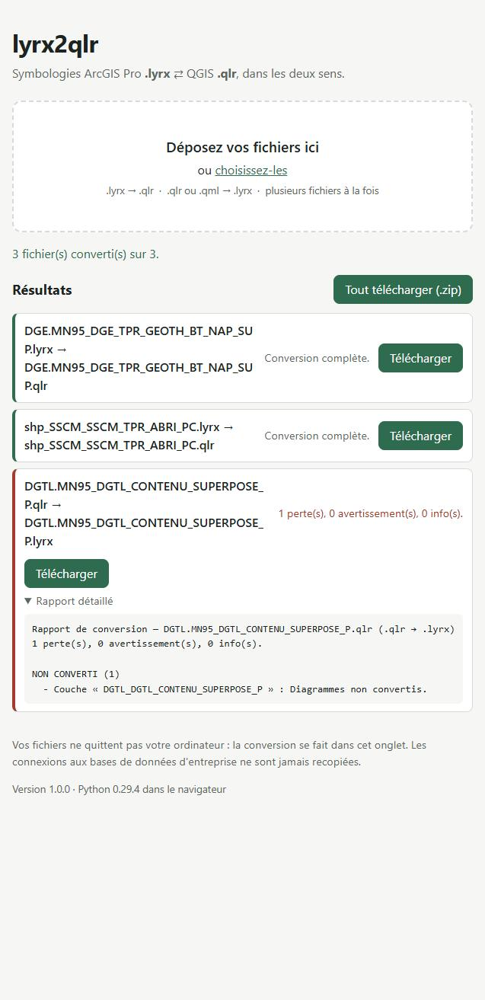

# lyrx2qlr

> **English:** lyrx2qlr converts ArcGIS Pro layer symbology (.lyrx) to QGIS layer definitions
> (.qlr), and back (.qlr or .qml to .lyrx). Use it in your browser at
> https://lyrx2qlr.papetche.ch/?lang=en (nothing is uploaded: Python runs in the page), as a
> QGIS plugin, or from the command line. Every conversion comes with a report of what could not
> be converted. Licensed under GPL-3.0.

Convertit les symbologies **ArcGIS Pro (.lyrx)** en couches **QGIS (.qlr)**, et inversement
(.qlr ou .qml vers .lyrx).

Il existe trois façons de s'en servir, et toutes utilisent le même code de conversion (le « cœur ») :

| Outil | Pour qui | Où |
|---|---|---|
| **Application web** | n'importe qui, sans rien installer | **https://lyrx2qlr.papetche.ch** (page statique `web/` ; Python tourne dans le navigateur) |
| **Extension QGIS** | utilisateurs de QGIS | menu « Extensions › lyrx2qlr » |
| **Ligne de commande** | traitements par lots, scripts | `lyrx2qlr dossier/ -o sorties/` |

Chaque conversion produit un **rapport** qui dit clairement ce qui n'a pas été converti
(rubrique « NON CONVERTI ») et ce qui est à vérifier (rubrique « À VÉRIFIER »).

Pourquoi ce projet ? Aucun outil gratuit et entretenu ne fait cette conversion dans les deux
sens (vérifié en novembre 2026, voir [docs/etat_de_l_art.md](docs/etat_de_l_art.md)).
Besoin et chances de succès : [docs/positionnement.md](docs/positionnement.md). Prochaines
étapes (ArcGIS Pro, extension officielle, anglais, code public) :
[docs/feuille_de_route.md](docs/feuille_de_route.md). Pour aider : onglet « Contribuer » de la page web, ou
[CONTRIBUTING.md](CONTRIBUTING.md) ; fonctionnement dans [docs/collaboratif.md](docs/collaboratif.md).



## Ce qui est converti

- Couches d'entités vectorielles : points, lignes, surfaces.
- Rendus : symbole unique, valeurs uniques (catégories, y compris sur plusieurs champs), classes.
- Symboles : aplats, traits et tirets, hachures, marqueurs simples, de police et image, grilles de
  points, marqueurs le long des lignes.
- Étiquettes (une ou plusieurs classes), échelles de visibilité, filtre de définition, alias des
  champs, transparence.
- Sources : shapefile, géodatabase fichier, GeoPackage. Les connexions aux bases de données
  d'entreprise ne sont **jamais** recopiées : la couche est marquée « à reconnecter ».

La liste complète de ce qui ne l'est pas encore : [docs/limites.md](docs/limites.md).

## Utiliser l'application web

En local :

```bash
python outils/construire.py web
```

```bash
python -m http.server 8765 --directory web
```

puis ouvrir http://localhost:8765, déposer un ou plusieurs fichiers, et cliquer sur
« Télécharger » ou « Tout télécharger (.zip) ». Les fichiers ne quittent pas l'ordinateur.

Elle est en ligne sur https://lyrx2qlr.papetche.ch. Pour la mettre ailleurs, il suffit de copier
le contenu du dossier `web/` (après la commande de construction, sans `_essai/`) sur n'importe quel
hébergement de pages statiques. L'image de partage `web/apercu.png` se refait avec
`outils/image_partage.py`.

## Installer l'extension QGIS (QGIS 3.40 ou plus récent)

```bash
python outils/construire.py extension
```

Cela produit `dist/lyrx2qlr_qgis-1.0.0.zip`. Dans QGIS : menu « Extensions › Installer/Gérer les
extensions », onglet « Installer depuis un ZIP », choisir ce fichier. Le menu
« Extensions › lyrx2qlr » propose ensuite :

- « Importer un fichier ArcGIS Pro (.lyrx)… » : ajoute la couche au projet ;
- « Exporter la couche active en .lyrx… » ;
- « Convertir un dossier (.lyrx ⇄ .qlr)… » : convertit tout un dossier et ses sous-dossiers, et
  enregistre un rapport `rapport_lyrx2qlr.txt`.

## Ligne de commande

Python 3.10 ou plus récent, sans aucune autre dépendance.

```bash
pip install -e .
```

```bash
lyrx2qlr mes_couches/ -o sorties/
```

Options utiles : `-r json` (rapport en JSON), `-c dossier` (catalogues complémentaires),
`--verifier-catalogues`, `-h` (aide).

Depuis Python :

```python
from lyrx2qlr import convertir
resultat = convertir(open("couche.lyrx", "rb").read(), "couche.lyrx")
print(resultat.rapport.en_texte())
open(resultat.nom_sortie, "wb").write(resultat.donnees)
```

## Ajouter une correspondance (maintenance)

Les correspondances entre ArcGIS et QGIS (types de symboles, propriétés, unités, couleurs, listes de
valeurs, polices, expressions, rendus…) sont dans des fichiers JSON, dans
`src/lyrx2qlr/catalogues/`. Pour convertir un nouveau cas, on ajoute une ligne dans le bon fichier,
**sans toucher au code**. Mode d'emploi : [docs/catalogues.md](docs/catalogues.md).

## Développement

Organisation :

```
src/lyrx2qlr/           le cœur (bibliothèque standard Python uniquement)
  catalogues/           les correspondances, en JSON
  modeles/              gabarits de départ (étiquettes QGIS, couche ArcGIS)
web/                    application web (index.html, app.js, passerelle.py)
qgis_plugin/            extension QGIS (le cœur y est copié par outils/construire.py)
exemples/               vrais .lyrx et .qlr, nettoyés (pas de connexion, pas de chemin réseau),
                        et cas inventés figés par la boucle d'entraînement (exemples/fabriques/)
tests/                  tests automatiques
outils/                 construction, aperçus dans QGIS, préparation des exemples
  entrainement/         boucle d'entraînement (symbologies inventées) et corpus (symbologies réelles)
corpus/                 419 symbologies réelles trouvées sur internet, chacune avec sa source (sources.json)
docs/                   état de l'art, positionnement, feuille de route, catalogues, limites, corpus…
```

Lancer les tests :

```bash
pip install -e ".[dev]"
```

```bash
pytest
```

Sous Windows, avec le Python fourni par QGIS (les tests « dans QGIS » s'exécutent alors aussi) :

```powershell
.\outils\py.ps1 -m pytest
```

Les tests :

- convertissent chaque exemple aller-retour (.lyrx → .qlr → .lyrx et .qlr → .lyrx → .qlr) et
  vérifient que rien ne change ;
- font charger chaque .qlr produit par QGIS lui-même, le font réenregistrer par QGIS, et vérifient
  que QGIS a tout compris ;
- pilotent l'extension QGIS sans écran ;
- vérifient les briques (couleurs, unités, expressions, catalogues, rapport).

Contrôle à l'œil : `outils/apercu_qgis.py` fait dessiner par QGIS chaque couche convertie, sur
vos propres données (dossier `donnees_locales/`, jamais publié), à côté de l'ancien .qlr pour
comparer.

Boucle d'entraînement : `outils/entrainement/boucle.py` invente des centaines de symbologies QGIS,
les convertit aller-retour et repère les écarts que le rapport ne signale pas. Mode d'emploi et
résultats : [docs/entrainement.md](docs/entrainement.md).

Corpus : `outils/entrainement/corpus.py` fait passer par l'aller-retour plus de 500 symbologies
réelles (Ordnance Survey, Defra, Données Québec, dépôts GitHub…) gardées dans `corpus/` avec leur
source. Mode d'emploi et résultats : [docs/corpus.md](docs/corpus.md).

GitHub Actions lance les tests à chaque envoi sur `main` (`.github/workflows/tests.yml`).

## Licence

Code sous licence **GNU GPL version 3 ou plus récente** (fichier [LICENSE](LICENSE)), comme QGIS.
Les fichiers de symbologie servant aux essais (corpus) ne sont pas dans le dépôt.

## Limites connues

- Les .lyrx produits sont vérifiés **dans ArcGIS Pro 3.7** : ouverts, réenregistrés et dessinés à
  côté de l'original (lot 2, voir [docs/lot2.md](docs/lot2.md)). Les dessins restent proches, pas
  identiques au pixel près (lissage, origine des hachures, glyphes de police).
- Voir [docs/limites.md](docs/limites.md).
